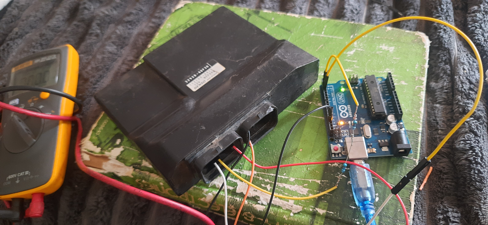
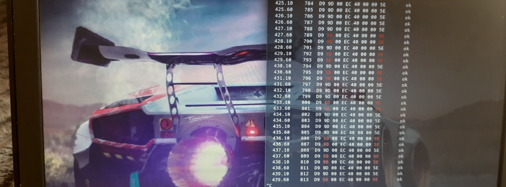

# Suzuki GSX-R1000 K1/K2 ECU – Bench Reverse-Engineering Notes

Bench work on a 2001–2002 Suzuki GSX-R1000 engine control unit
(Suzuki 32920-40F30, Denso 112100-0820), 22–23 November 2026.

**Status: closed.** The unit failed at the end of the second day: its
5 V sensor supply is shorted inside the case (section 7), and the case
cannot be opened here. The work continues on a K3 ECU in `../K3-K4`.

Repository: https://github.com/tendai98/GSXR1000-K1-K2-ECU-Experiment
Write-up: https://tendaibhebhe.com/writing/gsxr1000-k1-ecu/



## Results at a glance

- **The ECU's diagnostic output is pin 56 (TECH),** the line to the
  dash. It is a one-way 5 V UART at **7812.5 baud, 8N1**, sending one
  8-byte frame every 0.5 s, in user mode and dealer mode alike.
- **Every frame checksums:** all eight bytes sum to 0 mod 256.
- **Decoded:** the coolant sensor voltage (10 bits), the dealer-mode
  flag, the dealer-mode throttle-position mark, and nine fault codes
  (c13, c14, c15, c21, c22, c23, c29, c31, and probably c28). Full
  table in section 5.
- **Coolant calibrated:** the ECU pulls pin 51 up through about
  1.8 kΩ; sensor resistance = `1796 × raw / (1023 − raw)`.
- **Faults latch** until the ECU has been off for about ten seconds.
- **There is no K-line in the bike harness.** Dealer mode plus this
  stream is the whole of normal diagnostics on this model.
- **Tools:** a live decoder on the PC (`faults.py`) and a stand-alone
  version that runs on the Uno and was read on a phone
  (`ECUFAULTS.ino`).
- **The unit died** from a shorted 5 V supply, most likely after 12 V
  reached a 5 V pin during the last tests.

Out of scope: reading or writing the firmware and fuel maps. Pins 29–32
are a factory port with no harness wire; they were not used beyond the
early tests in 6.4–6.5.

---

## 1. Unit identification

| Label marking   | Meaning |
|-----------------|---------|
| 32920-40F30     | Suzuki part number. 32920 = FI control unit, 40F = 2001–02 GSX-R1000 |
| 112100-0820     | Denso's own part number (Denso manufactured the ECU) |
| 12V NEPO6J      | Voltage rating plus a Denso production/lot code |

- Listed as the FI control unit in the 2002 GSX-R1000 parts diagram.
- Related numbers for the same bike: 32920-40F00 (Denso 112100-0790),
  32920-40FD0 (Denso 112100-1210), 32920-40FA0 (Denso 112100-1180).
- Not interchangeable with 2003-on GSX-R1000 ECUs (32920-18Gxx).
- Service manual (p. 4-14): CPU, ROM and I/O sections; eight fuel maps
  in ROM.
- Processor: a Motorola CPU16 part, MC68HC916R3 (flash) or MC68HC16R3
  (mask ROM), per mr_hollywood's published work on these Denso units.
  Not confirmed on this unit.
- Case: solid plastic shell with rubbery gel in front of the connectors.
  Not opened.

---

## 2. Bench setup and rules learned

### Power

```
12 V supply (+) ── 10 Ω, 2 W or more ── ECU pin 17
12 V supply (−) ── ECU pin 18 and pin 35 ── Uno GND
```

- Supply: 12.14 V wall adapter (11.98 V on 23 Nov).
- The ECU draws about **190 mA**: 1.9 V across the 10 Ω, 0.36 W in it,
  pin 17 at about 10 V. **A ¼ W resistor burns at that.** A 12 V
  filament bulb (5–10 W) also works as the limiter and shows a short by
  lighting up. An LED does not work.
- Volts across the 10 Ω ÷ 10 = amps: under 0.5 V = not running,
  0.5–2.5 V = normal, near 12 V = short, disconnect.
- **Power-cycling:** leave it off about ten seconds. A short off-time
  once failed to clear a latched fault.

### Listening (Uno as a USB-serial bridge)

```
ECU pin 56 ── 1 kΩ ── Uno pin 1       Uno RESET ── Uno GND
```

- With RESET held low the Uno's USB chip is a plain serial adapter, and
  the labels swap: pin 1 (marked TX) carries data **into** the PC.
- The Uno's USB chip accepts 7812 baud exactly.
- Only one program can hold the port. Close the Serial Monitor and any
  other script first.

### Faking a sensor with a divider

```
pin 48 (5 V) ── R1 ──┬── R2 ── pin 54 (sensor ground)
                     │
                     └── ECU input under test
```

Two 5.1 kΩ give 2.5 V, which every pressure and throttle input accepts.
Coolant (pin 51) and intake air (pin 50) take a single resistor to
pin 54, because the ECU supplies the pull-up.

### Rules

1. Check supply polarity with the meter before connecting. The manual
   (p. 4-3) says reverse polarity damages the FI system instantly.
2. All grounds common: ECU pin 35, supply negative, Uno GND.
3. Supply resistor rated 2 W or more, or a filament bulb.
4. **12 V onto an input only through a resistor (9.87 kΩ used), and
   count the pin twice.** Never let 12 V touch a 5 V pin. Pin 21 (map
   select) and pin 29 are destroyed by it.
5. Meter every resistor and every pin before trusting a result.
   Mislabelled resistors and a probe one pin off each cost a test.
6. Load-test a pin before designing a divider for it; a weak source
   collapses under 10 kΩ.
7. Describe and draw every divider as its full path, with the voltage
   expected at the junction.
8. Check which ECU is on the bench at the start of every session.
9. Listen before driving. Everything decoded here came from listening on
   pin 56 and putting resistors on sensor inputs.

---

## 3. Connectors and pin numbering

- Two connectors: 34-pin and 26-pin, 4-row TE Connectivity style.
- Numbering runs continuously: pins 1–34 on the large plug, 35–60 on the
  small plug.
- Row layout: 1–9 / 10–17 / 18–25 / 26–34 and 35–41 / 42–47 / 48–53 /
  54–60.
- Verified by continuity between ground pins (6.1), the ECU powering
  from pin 17, and every sensor test in 6.8 landing on the pin the
  manual names.
- Full 60-terminal table with wire colours: `gsxr1000-ecm-pinout.html`
  (and `.pdf`), built from the service manual.

---

## 4. Pin map (pins used or measured)

All voltages to pin 35 with the ECU powered, before the failure.

| Pin | Label | Function | Measured / observed | Status |
|-----|-------|----------|---------------------|--------|
| 15  | ?     | 7-way coupler line (Bl/R) | 4.939 V open; 3.258 V with 9.87 kΩ load → ~5.1 kΩ pull-up | Pulled-up line, probably an input |
| 16  | ?     | 7-way coupler line (Bl/Y) | as pin 15 | Pulled-up line, probably an input |
| 17  | +B    | +12 V power input | 1.1 MΩ to ground unpowered | Confirmed |
| 18  | E02   | Ground | ~1 Ω to pin 35 | Confirmed |
| 19  | CLT   | Clutch lever switch | Grounded: no change in the stream | Not reported |
| 20  | NT    | Neutral signal | Grounded: no change in the stream | Not reported |
| 21  | MS    | Map select (per mr_hollywood). 12 V here destroys the ECU | 4.939 V open; ~5.1 kΩ pull-up; grounded: no change | Input, grounded by the harness |
| 22  | TS    | Dealer-mode select | Ground to enable; sets byte 2 bit 4 | Confirmed |
| 23–25 | ?   | 7-way coupler lines (Bl/W, Bl/B, Bl/G) | 4.36 V on the meter; ~1.3 MΩ source | High impedance, not driven |
| 26  | E03   | Ground per manual | 7.3 kΩ to pin 35 | **Anomaly**, should be a hard ground |
| 27  | E01   | Ground | ~1 Ω to pin 35 | Confirmed |
| 28  | STA   | Starter button signal | 2.439 V open, ~4 kΩ; 10.21 V when fed 12 V through 9.87 kΩ | Input; c11/c12 test not finished (6.13) |
| 29–32 | –   | Factory port, no harness wire | 29: 4.933 V; 30: 4.919 V; 31: 9.3 V; 32: 0.015 V | Not used. Pin 29 is the flash programming pin: never 12 V |
| 33  | ?     | Strap to sensor ground in the harness | 4.939 V open; ~5.1 kΩ pull-up; grounded: no change | Input |
| 35  | E1    | Ground (main) | Reference | Confirmed |
| 38  | MPS   | Exhaust valve position sensor | 0 V open; 2.475 V divider: no change | High-impedance input, not reported |
| 42  | VM    | Fuel pump relay monitor | 0 V open | Not tested (c41) |
| 45  | STP   | Secondary throttle position | 2.5 V clears c29 | Confirmed |
| 48  | VCC   | 5 V sensor supply | ~4.94 V; source for every divider | Confirmed. **Shorted after the failure** |
| 49  | VTA   | Throttle position | 2.5 V clears c14; dealer-mode mark at 1.06–1.18 V | Confirmed |
| 50  | THA   | Intake air temperature | 1 kΩ to pin 54 clears c21 | Confirmed |
| 51  | THW   | Coolant temperature | ~1.8 kΩ internal pull-up | Confirmed, calibrated |
| 52  | PA    | Atmospheric pressure | 2.5 V clears c22 | Confirmed |
| 54  | E2    | Sensor ground | – | Confirmed |
| 56  | TECH  | **Serial data to the dash** | 7812.5 baud; meter flickers 4.8–4.9 V | Confirmed |
| 57  | GP    | Gear position | 4.942 V open, ~1 kΩ pull-up; 0 V sets c31 | Confirmed |
| 58  | PM    | Intake air pressure | 2.5 V clears c13 | Confirmed |
| 59  | DON   | Tip-over sensor | 0.8 V clears c23 (divider pin 48 – 5.04 kΩ – pin 59 – 1 kΩ – pin 54); 0 V is a fault | Confirmed |
| 60  | AT    | Probably anti-theft / ignition switch | 9 V open, ~0.7 kΩ pull-up | Function inferred |

### The 7-way coupler beside the ECM

Traced on the '02 harness diagram (manual PDF p. 462). An unlabelled
7-way coupler next to the ECM carries pins 15, 16, 23, 24, 25, a red
wire on the 5 V supply, and sensor ground. Pins 15–16 are pulled up
through about 5.1 kΩ; pins 23–25 float. Possibly where aftermarket
fuel-trim boxes plugged in. Unverified.

---

## 5. Pin 56 dash stream protocol

- One-way, ECU → dash. Logic-level UART, idle high, not inverted.
- **7812.5 baud, 8N1.** One 8-byte frame every 500 ms. (128 µs per bit:
  the shortest pulse seen at every baud rate in the sweep.)
- The dash shows "CHEC" if no frame arrives for 5 seconds (manual
  p. 4-28).

```
byte:   1   2   3   4   5   6   7   8
        FF  C9  00  FC  40  00  00  FC     bare ECU, dealer mode off
```

| Byte | Bits | Meaning | Basis |
|------|------|---------|-------|
| 1    | all  | Coolant sensor voltage, high 8 bits of 10 | Proven |
| 2    | 7–6  | Coolant sensor voltage, low 2 bits | Fits all calibration points |
| 2    | 5    | Always clear | Unknown |
| 2    | 4    | Dealer mode (pin 22 grounded) | Proven |
| 2    | 2, 1 | Throttle mark, dealer mode only: `01` low, `11` middle, `10` high | Proven |
| 2    | 3, 0 | Always set; not clutch, neutral, pin 21 or pin 33 | Unknown |
| 3    | 2    | c31 gear position signal | Proven |
| 3    | others | Always clear | Unknown |
| 4    | 0, 1 | Probably c11, c12 (need 4 s of cranking) | Not tested |
| 4    | 2    | c13 intake air pressure sensor | Proven |
| 4    | 3    | c14 throttle position sensor | Proven |
| 4    | 4    | c15 coolant temperature sensor | Proven |
| 4    | 5    | c21 intake air temperature sensor | Proven |
| 4    | 6    | c22 atmospheric pressure sensor | Proven |
| 4    | 7    | c23 tip-over sensor | Proven |
| 5    | 5    | Probably c28 secondary throttle actuator; sets once pin 45 is valid | Inferred |
| 5    | 6    | c29 secondary throttle position sensor | Proven |
| 5    | others | Always clear | Unknown |
| 6, 7 | all  | Always `00` | Unknown |
| 8    | all  | Checksum: bytes 1–8 sum to 0 mod 256 | Proven on every frame |

Coolant: `raw = byte1 × 4 + (byte2 >> 6)`; 1023 = sensor open. The
lowest bit flickers between neighbouring values, so byte 2 alternates
(for example `9D` / `5D`).

Byte 4 follows the manual's code order with c11 at bit 0. Byte 5 does
not simply continue it.

Reference frames:

| Frame | Condition |
|-------|-----------|
| `FF C9 00 FC 40 00 00 FC` | Bare ECU, dealer mode off |
| `FF DD 00 FC 40 00 00 E8` | Bare ECU, pin 22 grounded |
| `38 89 00 EC 40 00 00 13` | 505 Ω on pins 51/54, c15 cleared |
| `FF DD 00 FC 20 00 00 08` | 2.5 V on pin 45, pin 22 grounded |
| `FF C9 04 FC 40 00 00 F8` | Pin 57 linked to pin 54 (c31 set) |
| `FF DF 00 FC 40 00 00 E6` | 1.12 V on pin 49, pin 22 grounded (throttle mark middle) |

Faults expected on a bare bench but **not** shown: c41 (fuel pump
relay), c42 (ignition switch), c46 (exhaust valve actuator).



---

## 6. Tests and results

### 6.1 Continuity (unpowered)
35↔18 ≈ 1 Ω, 35↔27 ≈ 1 Ω, 35↔26 = 7.3 kΩ, 35↔17 = 1.1 MΩ. Confirms the
numbering and no short on the power pin.

### 6.2 Power-up
ECU draws current, resistor warms, 5 V present on the 5 V pins.

### 6.3 Load test on pins 29/30 (10.2 kΩ to ground)
Pin 29: 4.933 → 4.693 V (~520 Ω source). Pin 30: 4.919 → 4.902 V
(~35 Ω, stiffly driven).

### 6.4 Passive listening on pins 29/30
No activity. Only a single pulse at power-off.

### 6.5 Active probing on pins 29/30
KWP2000-style start messages and single bytes at 1200–57600 baud,
using `SERIALCOM/SERIALCOM.ino`. No response at any speed. These pins
have no harness wire; the diagnostic output turned out to be pin 56.

### 6.6 Pin 56: stream found
The meter flickered on pin 56. Baud sweep 300–115200: the shortest low
pulse was 130–143 µs at every rate, one bit at 7812.5 baud. At 7812
baud: the same 8-byte frame every 500 ms, 40 times in a row.

### 6.7 Dealer mode (pin 22)
Grounding pin 22: byte 2 `C9` → `DD`, checksum follows. Nothing else
changes; the fault bytes are sent in both modes.

### 6.8 Fault-bit mapping
One sensor input at a time was given a valid level and the stream
watched for the bit that cleared.

| Pin | What was connected | Change | Result |
|-----|--------------------|--------|--------|
| 51 (THW) | resistor to pin 54 | byte 4 `FC` → `EC` | bit 4 = c15 |
| 50 (THA) | 1 kΩ to pin 54 | byte 4 `FC` → `DC` | bit 5 = c21 |
| 59 (DON) | 0.8 V divider | byte 4 `FC` → `7C` | bit 7 = c23 |
| 57 (GP)  | wire link to pin 54 | byte 3 `00` → `04` | byte 3 bit 2 = c31 |
| 45 (STP) | 2.5 V divider | byte 5 `40` → `20` | bit 6 = c29; bit 5 appears |
| 58 (PM)  | 2.5 V divider | byte 4 `FC` → `F8` | bit 2 = c13 |
| 49 (VTA) | 2.5 V divider | byte 4 `FC` → `F4` | bit 3 = c14 |
| 52 (PA)  | 2.5 V divider | byte 4 `FC` → `BC` | bit 6 = c22 |

- Pin 57 with 10 kΩ to pin 48 or 1 kΩ to pin 54 (2.488 V) changes
  nothing: still a valid gear voltage.
- With pin 45 valid, byte 5 bit 5 sets. Probably c28: the manual says
  that when the actuator and its sensor are both missing, only c29 is
  shown.
- c15 and c31 latch until a power cycle.

### 6.9 Coolant calibration (pin 51)

| Resistor (metered) | Raw | Resistance implied | Shown as |
|--------------------|-----|--------------------|----------|
| open     | 1023 | – | no reading |
| 5.04 kΩ  | 754  | 5034 Ω | about 3 °C |
| 2.16 kΩ  | 559  | 2164 Ω | about 23 °C |
| 505 Ω    | 226  | 509 Ω  | about 64 °C |

- `R_sensor = 1796 × raw / (1023 − raw)`: a 1.8 kΩ pull-up to 5 V.
- The ECU sends the voltage; the dash converts it to degrees.
- c15 sets as soon as the input opens and stays set until a power cycle.
  One short power cycle did not clear it; a longer one did.

### 6.10 Throttle-position mark (pin 49, dealer mode on)

| Pin 49 voltage | Byte 2 | Bits 2,1 | Mark |
|----------------|--------|----------|------|
| 0.625–1.06 V   | `DB`   | `01` | low |
| 1.12 V         | `DF`   | `11` | middle (correct position) |
| 1.18 V and up, or open | `DD` | `10` | high |

The correct window is narrower than 0.12 V, somewhere between 1.06 and
1.18 V. Its edges were not measured.

### 6.11 7-way coupler lines
See section 4. None toggles while the ECU idles.

### 6.12 Remaining inputs
Pins 38 (2.475 V), 19, 20, 21 and 33 (each grounded) changed nothing,
live or after a power cycle. The always-set bits 3 and 0 of byte 2 are
not clutch, neutral or either strap.

### 6.13 Starter signal (pin 28): not finished
Pin 28 idles at 2.439 V through about 4 kΩ and takes about 0.2 mA from
12 V through 9.87 kΩ: a normal 12 V switch input. A 5 s hold gave no
c11/c12; the manual needs 4 s of cranking, so a 15 s hold was planned.
The supply resistors started burning before it was run.

### 6.14 Stand-alone decoder on the Uno
`ECUFAULTS.ino` decodes the stream on the Uno itself (ECU pin 56 →
1 kΩ → Uno D2) and prints mode, coolant and named faults. On 22 Nov it
was read on a phone over USB with a serial-terminal app, with dealer
mode toggled by hand.


---

## 7. How the K1 died

During the pin 28 work the ¼ W supply resistors began burning. A K3 ECU
was then connected by mistake and measured as if it were the K1 for most
of a night; those notes are in `../K3-K4/captures/`. Once the mix-up was
found, the K1 measured:

| Test | Reading | Healthy |
|------|---------|---------|
| Pin 17 to pin 35, unpowered | 6.36 MΩ, OL reversed | ~1–5 MΩ |
| Powered through a 12 V 5 W bulb | bulb dim, pin 17 6.51 V | ~10 V |
| Pin 48 (5 V supply), powered | **1.813 V** | 4.94 V |
| Pin 48 to pin 35, unpowered | **2.3 Ω, 2.5 Ω reversed** | – |

The 5 V sensor supply is shorted inside the ECU. The regulator sits in
current limit, the unit draws more than normal, and the ¼ W resistors
burned. Likely failed part: a decoupling capacitor, the regulator, or a
chip on the 5 V line. Cause not proven; 12 V reaching a 5 V pin during
the pin 28 work is the leading candidate. Finding the part needs the
case open.

---

## 8. Tools in this folder

| File | Purpose |
|------|---------|
| `faults.py` | Live decoder: dealer mode, coolant temperature, named fault codes, and any set bits not yet identified. Prints when the frame changes. |
| `hexdump.py` | Live hex view of every frame with checksum check; changed bytes in red. `-c` shows changes only, `-l FILE` logs. |
| `listen.py` | Baud-rate sweep and raw capture into `captures/`. |
| `rawlisten.py` | Timestamped raw capture at one baud rate: `rawlisten.py BAUD SECONDS OUTFILE`. |
| `ECUFAULTS/ECUFAULTS.ino` | Stand-alone Uno decoder: ECU pin 56 → 1 kΩ → Uno D2, serial output at 115200. |
| `SERIALCOM/SERIALCOM.ino` | Sketch from 6.5, probing pins 29/30. |
| `captures/` | Raw captures, logs and `coolant_calibration.csv`. |
| `captures/session_2026-11-22.md` | Chronological log of every test, frame and meter reading. |
| `img/` | Bench photo, live frames, and the Uno decoder on a phone. |
| `website/` | Write-up for tendaibhebhe.com (see its `README.md`). |
| `gsxr1000-ecm-pinout.html` / `.pdf` | Full ECM coupler pinout. |
| `gsxr1000.pdf` | 2001 service manual (image scan). |

The Python scripts are listen-only and default to `/dev/ttyACM0` at
7812 baud. To add a fault bit, add a line to `KNOWN` in `faults.py` and
`KNOWN[]` in `ECUFAULTS.ino`.

Useful manual pages (PDF page numbers): 197 FI wiring diagram; 198–203
self-diagnosis and dealer mode; 204–205 code table; 206–223 per-code
charts; 384 "CHEC" note; 458–464 wiring diagrams.

---

## 9. Left unfinished

- c11/c12: clear c23, then 12 V through 9.87 kΩ on pin 28 for 15 s.
- c41: 12 V through 9.87 kΩ on pin 42, power-cycle, watch bytes 5–7.
- Edges of the throttle "middle" window.
- Pins 15, 16, 23, 24, 25 watched at power-up.

Open questions:

- Which part failed, and exactly what put 12 V where.
- Why pin 26 reads 7.3 kΩ when the manual shows it as ground.
- What the 7-way coupler is for.
- Which code byte 5 bit 5 is, and the layout of bytes 3, 5, 6 and 7.
- Why c41, c42 and c46 do not show on a bare bench.
- What the always-set bits 3 and 0 in byte 2 mean.

---
